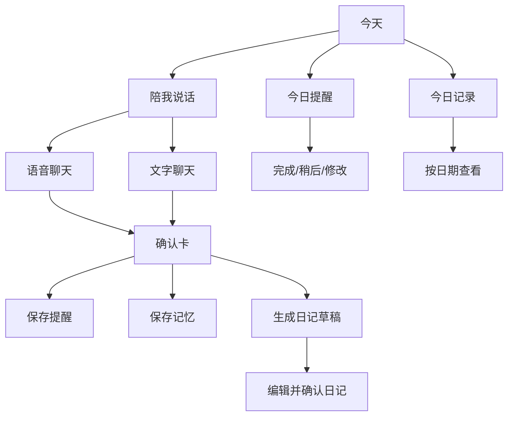

# iFrame 长辈陪伴移动端交互设计 v1

日期：2026-10-21

状态：网页先行路线已确认，详细交互待验证
目标：先为长辈提供独立移动端网页（H5），通过真实交互验证后再正式切换 iOS/Android 原生应用，以语音为主、文字为辅，帮助记录日常、确认提醒、进行主动问候，并把已确认的聊天内容整理成可编辑日记。

## 1. 证据与范围

### 已观察到的代码事实

- `src/apps/agent_api.py` 已有 Agent 会话、跨会话已确认记忆、陪护技能和语音转写相关入口。
- `frontend/src/components/modules/playground/useAgentConversation.ts` 已能发送文字和陪护技能配置。
- 现有 `schedule` 技能只能整理聊天中的安排；它明确要求没有真实日历或闹钟工具时，不能声称已创建提醒或会主动通知。
- 当前 Agent 上下文只携带有限的最近消息；历史查询入口已经存在于创作台 Agent，但不是适老移动端的信息架构。

### 直接含义

移动端需要一个独立的任务与通知层，不能只复用聊天接口来模拟提醒。日记也需要独立的草稿、确认、编辑和删除状态，不能把一条 Agent 回复直接当成日记。

### 尚未证明

- 当前服务是否具备可靠的后台任务调度、系统本地通知、远程推送、锁屏语音播放和离线语音识别。
- 原生阶段使用 React Native/Expo、Flutter 或 Swift/Kotlin，待网页交互验证和平台能力评估后确定。
- 长辈用户对自动发送、主动聊天频率和家属通知的接受度。

### 设计假设

- 第一版面向 iOS Safari 与 Android Chrome 的移动端网页；具体兼容性须真机验证。语音转写依赖服务端，网络不可用时至少保留文字输入和本地未发送草稿。
- 重要写入均需要长辈确认；“主动问候”默认是可关闭、可限频的提醒，而不是无限制陪聊。
- 音频原始文件默认在转写后删除，除非用户明确选择保存。

## 2. 产品定位

产品首页只回答三个问题：

1. 现在可以和我说话吗？
2. 今天有什么需要记住的事？
3. 我刚才说过的内容在哪里？

移动端使用浅色高对比界面，主色采用安静的蓝色 `#0369A1`，确认操作使用绿色 `#16A34A`，错误使用红色 `#DC2626`。正文默认 18px，标题 26–32px；支持系统动态字体。所有主要触控区域至少 48dp，底部导航不超过 4 项，关键操作同时显示图标和文字。

不使用复杂卡片网格、悬浮菜单、只依赖手势的操作或低对比灰字。语音播放、录音、提醒和保存都必须有明显的状态文字。

## 3. 信息架构

底部导航：

- **今天**：问候、主录音按钮、最近提醒、最近日记。
- **聊天**：完整对话和历史搜索。
- **日记**：按日期查看、编辑、删除、重新整理。
- **更多**：提醒管理、语音设置、隐私、家属协助、帮助。

## 4. 核心页面

### 4.1 今天

顶部显示“早上好，XX”和日期。中间只有一个主操作“点一下，说说今天”。点一下开始、再点一下结束，避免必须持续按住；可在设置里切换按住说话。开始后立即显示录音时长、音量反馈和“正在听，点这里结束”；结束后先展示转写文字，长辈可以朗读、修改、重录或发送。

下方依次显示：

- 下一条提醒：时间、事项、操作“完成/稍后”。
- 最近一条日记：标题、日期、操作“继续编辑”。
- 主动问候状态：显示下次问候时间和“暂停今天”。

首页不自动滚动，不使用轮播，不让重要操作藏在通知栏里。

### 4.2 聊天

聊天消息同时提供文字和播放按钮。Agent 回复默认短句，超过约 3 个段落时折叠为“继续听”。

输入区：

- 左侧大麦克风按钮：语音输入；录音结束先转写，不自动发送。
- 中间文字框：支持手动输入和编辑转写结果。
- 右侧发送按钮：无内容时禁用。

聊天回复中的可操作结果使用确认卡：

- “我记下了：明天 15:00 去社区活动。要设置提醒吗？”
- “我可以把今天的聊天整理成日记草稿，要现在整理吗？”
- “这是你刚才提到的个人信息，是否保存为以后可用的记忆？”

确认卡必须显示来源消息、目标日期/时间和取消入口。模型不能自行写入提醒、记忆或日记。

### 4.3 提醒

提醒列表按“今天、明天、以后”分组，每条显示绝对日期、时间、事项和状态。相对日期必须先转换为用户时区的绝对日期再确认。

创建流程：

1. 长辈说“明天下午三点去社区活动”。
2. Agent 复述“2026 年 10 月 22 日 15:00，社区活动”。
3. 长辈点击或说“确认”。
4. 服务端创建提醒并返回任务 ID；只有成功后显示“已设置提醒”。

药物相关内容只记录用户或医生明确说出的事项，不推断剂量、不修改用法。缺少日期或时间时显示“待确认”，不能补造。

提醒到点时设计目标为系统通知、声音和振动；通知权限关闭或任务创建失败时，界面必须明确告知。闭屏或应用退出时不能承诺自动开始语音聊天；使用系统允许的通知邀请打开应用。区分“已设置”“已调度”“已提交系统通知”“用户已确认”，不能以服务器发送成功宣称用户已收到。各平台后台/通知限制须在选定技术栈后核对官方文档并做真机验证。

### 4.4 日记

“今日记录”是一个可编辑草稿，不是模型直接生成的事实。默认结构：

- 今天发生了什么
- 我的感受
- 我提到的人和地点
- 明天要记得什么

每段后显示“来自聊天 10:32”的来源标记。模型推断或不确定内容使用“可能/待确认”标识，不进入已确认事实段。

长辈可以：播放朗读、编辑文字、删除段落、重新整理、确认保存。修改已保存日记时保留版本记录；删除日记可分别选择是否删除来源转写和已选择保留的音频。确认删除后清理对应衍生版本；其他日记或提醒依赖同一来源时需先说明影响。

日记生成触发方式：

- 手动：“整理今天的聊天”。
- 晚间窗口：若用户已授权，生成草稿通知，不自动发布。
- 连续多日未确认时暂停自动草稿，等待用户重新开启。

### 4.5 更多与设置

设置按长辈常用顺序排列：

1. 我的称呼与时区
2. 字体大小、对比度、语音速度和音量
3. 问候时间、安静时段、每日最多主动问候次数
4. 提醒通知、声音、振动
5. 隐私与数据删除
6. 家属协助（可选）

所有设置都提供“恢复默认”和明确的返回按钮。不要把隐私、删除和通知权限藏在三级菜单中。

## 5. 主动问候与主动聊天

主动行为分三层：

- **提醒型**：到点提醒用户已确认的事项。
- **问候型**：在用户授权的时间窗口发送一句简短问候，例如“早上好，今天睡得好吗？”
- **跟进型**：用户上一轮明确说“下午回来告诉我结果”时，在约定时间询问一次。

规则：

- 默认关闭主动聊天；首次引导可邀请用户明确开启问候试用，不预先勾选。
- 支持安静时段、每日次数上限和“暂停今天”。
- 一次未回应不重复轰炸；连续未回应不能自动推断发生危险。
- 只有用户明确配置家属联系人和升级条件后，才允许发送家属通知。
- 不使用“我一直在等你”“你不理我我会难过”等制造依赖的表达。
- 每条主动消息显示“为什么现在问候”和“停止主动问候”。

## 6. 语音交互

- 首次使用时请求麦克风、通知和语音播放权限，并用一句话解释用途。
- 录音最长 60 秒；超过时先自动结束并保留转写草稿。
- 录音结束后显示原文、编辑、重录、发送四个操作。
- 支持普通话，并在验证后逐项开放方言/口音支持；识别不确定时显示“我没听清，请再说一次”。
- 回复支持“播放、暂停、再听一遍、调慢语速”。
- 网络失败时保留本地转写草稿或提示切换文字输入，不能显示空白失败页。
- 可选免手模式，但默认仍要求明确的开始/结束提示，避免误录。

## 7. 数据与服务边界

建议新增独立移动端服务对象：

| 对象 | 关键字段 | 说明 |
|---|---|---|
| conversation | owner、title、created_at、last_message_at | 聊天会话元数据 |
| message | conversation、role、text、audio_ref、source | 可追溯的文字/语音来源 |
| reminder | title、start_at、timezone、status、source_message_id | 已确认后才创建 |
| journal_draft | date、sections、source_message_ids、status、version | draft/confirmed/deleted |
| proactive_event | kind、scheduled_at、reason、status、consent | 问候和跟进任务 |
| consent | notifications、proactive_chat、caregiver、audio_retention | 每项单独撤销 |

所有对象按 owner 隔离。音频引用、消息来源和日记版本使用稳定 ID，不用文件 URL 作为身份。删除聊天时，服务端必须明确处理关联日记、提醒来源和音频的保留规则。

## 8. 技术分层建议

- 第一阶段采用独立 H5 界面，沿用仓库 React/Next.js 技术栈，共享后端能力。正式原生迁移在网页交互验证后启动；不预先绑定原生框架。
- 网页阶段验证录音、纠错、文字聊天、回复朗读、历史查询、日记和提醒确认流程。关闭网页、锁屏和后台主动通知属于平台能力验证，需与交互可用性分别记录；模拟提醒必须标明演示状态。
- 语音采集/播放、通知与权限通过独立接口连接界面，业务状态和数据契约可供后续原生复用；不提前实现原生专属模块。
- 共享能力：复用 Agent 会话、模型路由、身份和 owner 隔离；移动端不直接复用创作台的复杂 Composer。
- 新增服务：提醒调度、系统通知/推送、日记草稿与版本、主动问候策略、音频保留策略。
- 任务可靠性：提醒和主动问候必须有持久化任务状态、幂等键、失败重试和用户可见日志。
- 模型输出：先生成结构化草稿，再由受限 API 在确认后写入；模型不能直接执行提醒、删除或家属通知。

## 9. 分阶段交付

### 网页验证与原生切换门槛（用户已确认）

先完成可操作的 H5 原型，在真实手机上邀请长辈试用，再开始正式原生迁移。原生切换前必须留下任务记录、问题清单、修订后的流程和复测结果。

验证任务：录音并停止、修改识别错误后发送、暂停/重听回复、找回昨天的聊天、确认/更改提醒时间、生成/修改/保存日记。记录独立完成情况、求助点、误触、放弃原因和主观感受；约 5 人的形成性测试用于发现问题，不宣称统计显著效果。

原生切换条件：核心任务的阻断问题已修复并复测；转写和保存状态能被用户理解；提醒及日记不会因误触或识别错误产生未经确认的写入；未解决的网页平台限制有明确的原生验证计划。测试结果不达标时继续迭代网页交互，不以更换技术栈替代交互修正。

### Phase 1：语音陪伴与日记草稿

语音转写、文字编辑发送、短回复朗读、会话历史、手动生成日记草稿、编辑与确认、字体和语音设置。

### Phase 2：真实提醒

网页阶段先验证提醒 CRUD、绝对日期确认、重复提醒、安静时段和完成/稍后交互。实际通知按浏览器能力单独实现与验证；可靠的系统本地通知作为原生阶段的能力验证项。

### Phase 3：主动问候

授权后按窗口发送问候、跟进型提醒、频率上限、暂停、无回应降级策略和家属联系人配置。

### Phase 4：家属协助与可靠性

家属只读视图、长辈逐项授权、数据导出/删除、离线草稿、跨设备恢复、通知送达监测。

## 10. 验收指标

- 70 岁以上新用户在没有培训的情况下能完成“录音—修改—发送”。
- 长辈能听懂并确认提醒的绝对日期和时间，错误日期可在确认前修改。
- 日记中每个事实都能回到来源消息；未确认内容不会进入已确认段落。
- 关闭通知或主动问候后不再产生对应任务。
- 录音、提醒、日记失败都能看到原因和重试入口。
- 375px 小屏、横屏、大字体和系统读屏下，主要操作仍可完成；动画关闭时功能不受影响。

## 11. 下一步

1. 先做独立 H5 交互原型，明确原型模拟数据与真实保存的边界；确认音频留存和 MVP 范围。
2. 以 Phase 1 做低保真原型和约 5 位长辈的形成性可用性测试；样本用于发现障碍，不作为统计效果证明。
3. 在提醒调度服务上线前，不对用户宣称“已经设置提醒”或“会主动联系”。
4. 网页交互复测通过后确定原生技术栈与迁移范围，再验证锁屏通知、后台恢复和弱网行为。

设计辅助：使用 ui-ux-pro-max 的适老可访问性、触控与字号检查。其自动检索返回了应用商店着陆页布局和拉丁字体，均不适用于本项目；未采用。此文档为设计提案，不代表功能已经实现或真机验证通过。
